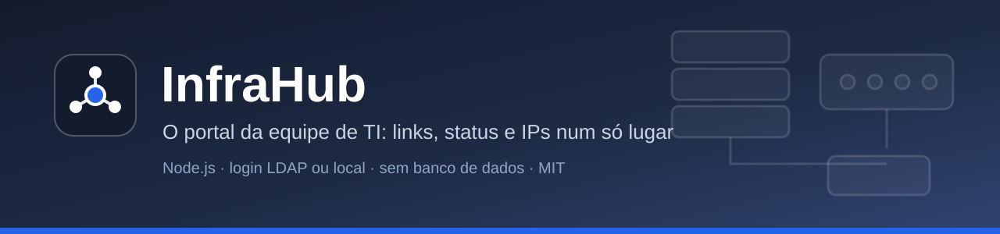
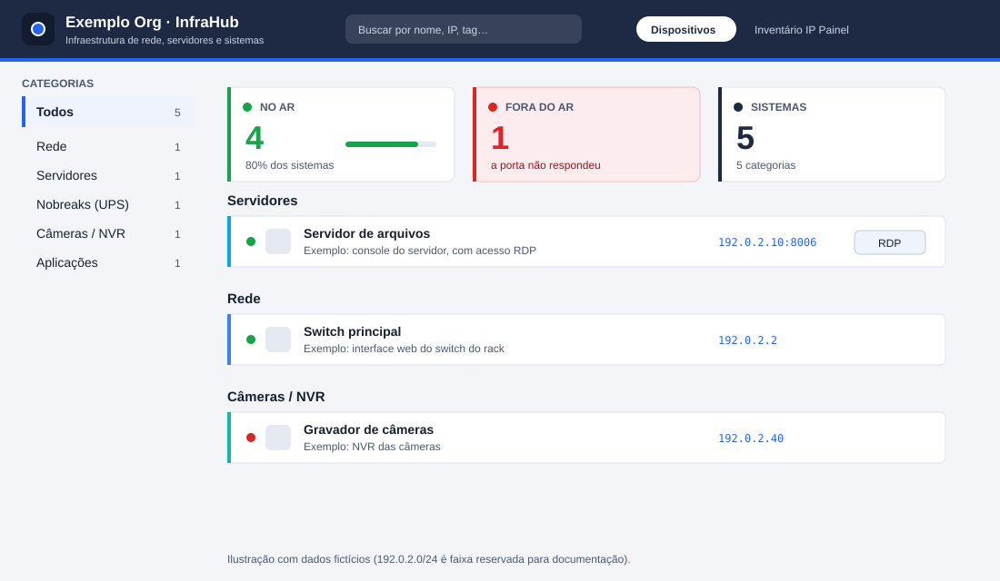
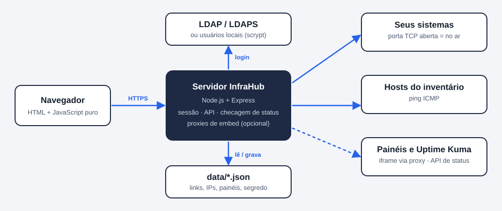

<p align="center"></p>

# InfraHub

**O portal da equipe de TI:** todos os links de administração (switches, servidores, nobreaks, câmeras, sistemas internos) com **status ao vivo**, um **inventário de IPs**, painéis embutidos e login por **LDAP** ou usuários locais. Feito para a equipe de infraestrutura de uma organização pequena ou média que hoje guarda tudo isso em favoritos, planilhas e na memória.

[](https://github.com/ewertonbsilva/InfraHub/actions/workflows/testes.yml)
[](LICENSE)

## Por que existe

Em toda infraestrutura há dezenas de interfaces web: o gerenciamento de cada switch, a console de cada servidor, o painel do nobreak, o gravador de câmeras. Os endereços ficam espalhados, ninguém sabe qual está fora do ar e o inventário de IPs mora numa planilha desatualizada. O InfraHub junta isso numa tela só, protegida por login, e não exige banco de dados nem agente instalado nas máquinas.

## O que ele faz

- **Dispositivos:** links organizados por categoria, com busca (nome, IP, tag), ordem alfabética e uma **bolinha de status** por sistema (a checagem tenta abrir a porta TCP do endereço cadastrado). Os cartões de números (no ar, fora do ar, verificando) **acompanham a categoria e a busca** e funcionam como filtro: clique em "Fora do ar" para ver só os que não responderam.
- **Inventário IP:** tabela dos hosts de uma rede (final `.1` a `.254`) com nome, observação, RDP opcional e status por *ping*.
- **Painel:** embute páginas de outros sistemas (Beszel, Grafana...) em abas, mesmo quando elas proíbem *iframe* (por um proxy de embed opcional).
- **Links:** página nativa com os monitores de uma *status page* do [Uptime Kuma](https://github.com/louislam/uptime-kuma) (opcional; a aba some se o Kuma não estiver configurado).
- **RDP com um clique:** se o item tem um host RDP, aparece o botão "RDP", que abre o `mstsc` direto no host (protocolo `infrahub-rdp://`, ver [RDP no Windows](#rdp-no-windows)).
- **Administração na própria tela:** botão **Admin** para adicionar, editar e excluir links, categorias, IPs e painéis.
- **Login** por LDAP (LDAPS, com restrição por grupo) e/ou usuários locais, com "Lembrar de mim", limite de tentativas e proteção contra CSRF. Veja [docs/AUTENTICACAO.md](docs/AUTENTICACAO.md).

### O que ele **não** faz

- Não é um sistema de monitoramento completo: o status é "a porta respondeu ou não", sem histórico, métricas ou alertas (para isso use o Uptime Kuma, Zabbix ou similar, e embuta o painel aqui).
- Não tem papéis: todo usuário autenticado pode editar. Quem entra é controlado por `ALLOWED_GROUP` e `LOCAL_USERS`.
- Não verifica o certificado dos sistemas monitorados (só abre a porta) e não guarda senhas dos sistemas, só links.

<p align="center"></p>

## Arquitetura

<p align="center"></p>

- Servidor único em **Node.js + Express**; o front-end é HTML e JavaScript puros, sem *build*.
- Dados em três arquivos JSON na pasta `data/` (links e categorias, inventário de IPs, painéis), criados a partir de `seed/` na primeira execução. Sem banco de dados.
- Sessão em cookie assinado (sem estado no servidor).
- O servidor é quem checa o status (porta TCP e *ping*), então ele precisa **enxergar** os sistemas e hosts cadastrados. O navegador só fala com o servidor.

## Requisitos

- **Docker** com Compose (recomendado) **ou** Node.js 20+.
- Para o *ping* do inventário no modo sem Docker: o comando `ping` do sistema. (No contêiner, o Alpine já traz.)
- Um servidor LDAP com LDAPS, **ou** nenhum (use usuários locais).

## Instalação

### Com Docker (recomendado)

```bash
git clone https://github.com/ewertonbsilva/InfraHub.git
cd InfraHub
cp .env.example .env
mkdir -p data && sudo chown 1000:1000 data       # o contêiner roda como o usuário "node" (uid 1000)
```

Crie um usuário local de teste e cole a linha gerada no `.env`:

```bash
docker run --rm -it -v "$PWD":/app -w /app node:22-alpine sh -c "npm ci --omit=dev >/dev/null && node scripts/hash-senha.mjs ana.silva"
# copie a linha LOCAL_USERS=... para o .env
```

Suba:

```bash
docker compose up -d --build
docker compose logs -f infrahub
```

Abra `http://localhost:5010` e entre. O log da partida mostra quais métodos de login estão ativos.

### Sem Docker

```bash
npm ci --omit=dev
cp .env.example .env            # ajuste; depois exporte as variáveis (ex.: set -a; . ./.env; set +a)
npm run hash-senha -- ana.silva # cole a linha LOCAL_USERS=... no .env
node server.js                  # porta 3000 (variável PORT)
```

O Node não lê o `.env` sozinho: carregue as variáveis no ambiente (ou use `node --env-file=.env server.js` no Node 20.6+).

### Atualizando

```bash
git pull && docker compose up -d --build
```

Os dados ficam em `data/` e sobrevivem à atualização. **Faça backup dessa pasta.**

## Configuração

Tudo por variáveis de ambiente (arquivo `.env`). O [`.env.example`](.env.example) lista todas, comentadas.

| Variável | Padrão | Para que serve |
|---|---|---|
| `ORG_NOME` | vazio | Nome mostrado como "`<ORG_NOME>` · InfraHub" |
| `LOCAL_USERS` | vazio | Usuários locais `usuario:hash` (gere com `npm run hash-senha`) |
| `LDAP_HOST` | vazio | Servidor LDAP (nome DNS do certificado). Vazio = sem LDAP |
| `LDAP_PORT` | `636` | Porta LDAPS |
| `LDAP_BASE` | — | Base dos usuários (obrigatória com LDAP) |
| `LDAP_USER_DN` | `uid={usuario},{base}` | Molde do DN usado no *bind* |
| `LDAP_CA` | vazio | PEM da autoridade do servidor LDAP (vazio = autoridades do sistema) |
| `ALLOWED_GROUP` | vazio | DN do grupo permitido. **Vazio = qualquer usuário do diretório** |
| `SESSION_SECRET` | gerado | Segredo do cookie (≥ 32 caracteres) |
| `IDLE_SECONDS` / `MAX_LIFE_SECONDS` | `900` / `28800` | Sessão normal: 15 min sem uso, 8 h no máximo |
| `REMEMBER_IDLE_SECONDS` / `REMEMBER_MAX_SECONDS` | 7 dias / 30 dias | Sessão com "Lembrar de mim" |
| `ALLOWED_CIDRS` | vazio | Redes autorizadas (CIDR). **Vazio = qualquer origem** |
| `TRUSTED_PROXIES` | vazio | Proxy reverso confiável (para enxergar o IP real) |
| `EMBED_PROXIES` | vazio | `porta=url,…`: proxies de embed (**sem login**, ver Segurança) |
| `EMBED_INSECURE_TLS` | `0` | `1` aceita certificado autoassinado nos alvos de embed |
| `KUMA_BASE` / `KUMA_SLUG` | vazio | Uptime Kuma e *status page*; habilitam a aba "Links" |
| `KUMA_PUBLIC_URL` | vazio | Endereço do Kuma visto pelo navegador (botão "Abrir status completo") |
| `PORT` | `3000` | Porta do servidor (no Docker, mapeie em `docker-compose.yml`) |

Sem `LDAP_HOST` e sem `LOCAL_USERS` o servidor **não inicia** e diz o que falta.

### Primeiros passos na tela

1. Entre e clique em **🔧 Admin** (canto superior direito) para ligar o modo de edição.
2. **🗂️ Categorias** cria as suas categorias; em cada categoria, **+ Adicionar link** cadastra nome, URL, descrição, tags e (opcional) o host RDP.
3. Em **Inventário IP**, ajuste a rede no arquivo `data/ips.json` (campo `network`, ex.: `"192.0.2"`) e cadastre os hosts.
4. Em **Painel**, cadastre páginas para embutir (ver `EMBED_PROXIES`).
5. Ícones: no cadastro do link, informe `icons/meu-sistema.svg` (coloque o arquivo em `public/icons/`) ou uma URL. Sem ícone, vale o `favicon.ico` do próprio sistema.

Os exemplos que vêm de fábrica (`seed/`) usam endereços fictícios (`192.0.2.x`): apague-os depois de conhecer a ferramenta.

## Painéis embutidos

Muitas páginas (Grafana, Beszel, Kuma) proíbem aparecer dentro de um *iframe*. Com `EMBED_PROXIES="3001=http://192.0.2.20:8090"` o InfraHub abre a porta 3001 e repassa para o alvo **removendo** os cabeçalhos que bloqueiam o *iframe*. Cadastre o painel com a URL `proxy://3001` (o navegador usa o host atual na porta indicada) e publique a porta no `docker-compose.yml`.

> ⚠️ **Essas portas não pedem login:** quem alcançar a porta vê o painel alvo. Use `ALLOWED_CIDRS` (vale também para elas) e não as exponha fora da rede de administração.

## RDP no Windows

O botão "RDP" abre uma URL `infrahub-rdp://host[:porta]`. Para o Windows entender, cada PC precisa de um *handler* registrado, que só chama o `mstsc /v:host`:

1. Copie `public/rdp/infrahub-rdp-handler.ps1` para `C:\ProgramData\InfraHub\`.
2. Registre o protocolo para o usuário (sem administrador): rode `public/rdp/Registrar-ProtocoloRDP.ps1`, ou importe `Registrar-ProtocoloRDP.reg`. Para desfazer: `-Remover` ou `Remover-ProtocoloRDP.reg`.
3. Em grande escala, distribua o *handler* por GPO (Preferências → Arquivos) e rode o registrador como *script* de logon.

A URL chega ao *script* como **argumento** (nunca dentro de um comando) e o host é validado por regex (letras, números, ponto e hífen, porta opcional); qualquer outra coisa é descartada. `Testar-ProtocoloRDP.ps1` confere isso, incluindo tentativas de injeção.

## Segurança

Os princípios (e o que fazer ao achar uma falha) estão em [SECURITY.md](SECURITY.md). Resumo para quem instala:

- Coloque o InfraHub atrás de **HTTPS** e informe o proxy em `TRUSTED_PROXIES`. Sem HTTPS, a senha trafega em texto puro.
- Defina `ALLOWED_GROUP` (com LDAP) e `ALLOWED_CIDRS`. Os padrões vazios significam "qualquer um" por serem os únicos que funcionam sem conhecer a sua rede.
- Mantenha as portas de embed fora de redes não confiáveis.
- Quem edita pode **cadastrar URLs**: o servidor só as usa para abrir uma porta TCP e o navegador só as abre quando você clica. Mesmo assim, só dê acesso a quem você confia para editar.
- Guarde `.env` e `data/` com permissão restrita.

## Desenvolvimento e testes

```bash
npm ci
npm test                      # testes do login, sessão, hash, CSRF, limite de tentativas
node --check server.js auth.js public/app.js
npm run dev                   # recarrega ao salvar
```

Os testes não precisam de rede, LDAP ou Docker. Veja [CONTRIBUTING.md](CONTRIBUTING.md).

Estrutura:

```
server.js          rotas, checagem de status, proxies de embed
auth.js            LDAP, usuários locais, sessão, CSRF, limite de tentativas
public/            front-end (index.html, app.js, styles.css, base.css) e scripts RDP
seed/              dados de exemplo (copiados para data/ na 1ª execução)
data/              dados em uso (ignorado pelo Git)
scripts/           gerador de hash de senha
test/              testes
docs/              documentação e imagens
```

## Perguntas frequentes

**O status "fora do ar" aparece, mas o sistema abre no meu navegador.** O servidor do InfraHub é quem testa a porta, e ele pode estar em outra rede ou ter regra de firewall diferente da sua. Garanta que ele alcance o endereço e a porta cadastrados.

**O inventário mostra tudo "offline".** O *ping* é ICMP. Verifique se o contêiner/servidor tem rota até a rede e se os hosts respondem a *ping*. No Docker, redes isoladas (*bridge* com NAT) normalmente funcionam; `network_mode: host` ajuda quando não.

**Esqueci a senha de um usuário local.** Gere um novo hash e troque no `.env`; reinicie o contêiner.

**Posso usar atrás de um proxy reverso com caminho (`/infrahub`)?** Ainda não: o front-end usa caminhos absolutos. Publique por um subdomínio.

**Como mudo as cores?** Os *tokens* estão no início de `public/base.css` (`--ih-*`).

## Ideias para o futuro

- Papéis (somente leitura x edição).
- Histórico simples de disponibilidade.
- Importar/exportar o inventário em CSV.
- Suporte a IPv6 no inventário.

## Licença

[MIT](LICENSE). Use, copie e modifique à vontade, mantendo o aviso de copyright. Sem garantia.
